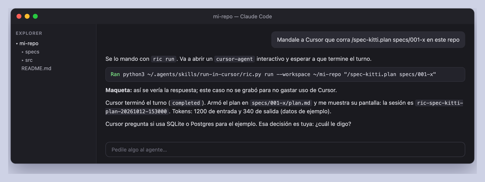

# run-in-cursor

Una skill para Claude Code, Codex y Cursor, y un CLI (`ric`), que le manda trabajo al agente de Cursor desde otro agente
y deja la sesión registrada como uso real de Cursor: turnos, modelo y tokens llegan a los hooks igual que cuando alguien
escribe en Cursor. Es una sola skill, pero hace cuatro cosas distintas, y cada una es algo que le pedís al agente:

| Le decís al agente… | Y la skill… |
|---|---|
| *«Mandale a Cursor `/spec-kit.plan specs/001-x`»* | abre un `cursor-agent` interactivo en el repo, espera a que termine el turno y te muestra su pantalla, el estado y los tokens |
| *«Decile que SQLite»* (cuando Cursor te hizo una pregunta) | responde en la misma sesión y espera el turno siguiente, que queda registrado como uno más |
| *«Cerrala»* | cierra la sesión con `/quit`, para que Cursor mande el evento de fin de sesión |
| *«Mandale esto, pero que no haga push»* | se niega a enviar un texto que coincide con las expresiones que le pasás con `--deny`, antes de abrir nada |

**Cursor corre sus comandos de shell sin pedir aprobación (`--force`).** Lo que publica (push, escrituras en Jira,
deploys) conviene dejarlo para vos o frenarlo con `--deny`; esa regla es una lista de expresiones regulares sobre el
texto que se envía, no una barrera sobre lo que Cursor decida hacer. Más detalle en el [showcase](docs/showcase.md#4-frenar-lo-que-te-reservás).

## Elegí por dónde empezar

| Componente | Qué resuelve | Cursor | Se instala con | Showcase | Instalación |
|---|---|---|---|---|---|
| **`run-in-cursor`** (`ric run`) | Mandar un prompt o un slash command a Cursor y esperar su turno | Corre con `--force` en tu repo | `./install.sh` | [Ver el caso](docs/showcase.md#1-mandar-un-slash-command-a-cursor) | [Instalar](docs/instalacion.md#1-instalar) |
| **`run-in-cursor`** (`ric send`) | Contestarle a Cursor cuando pregunta algo, en la misma sesión | Un turno más, registrado | `./install.sh` | [Ver el caso](docs/showcase.md#2-contestarle-a-cursor-cuando-pregunta) | [Instalar](docs/instalacion.md#1-instalar) |
| **`run-in-cursor`** (`ric quit`) | Cerrar la sesión para que Cursor mande `sessionEnd` | Cierra una sesión tuya | `./install.sh` | [Ver el caso](docs/showcase.md#3-cerrar-la-sesión) | [Instalar](docs/instalacion.md#1-instalar) |
| **`ric hook`** (hook global) | Anotar el fin de cada turno, con estado y tokens, solo en las sesiones que lanzó `ric` | Se agrega a `~/.cursor/hooks.json` | `./install.sh` (corre `ric install-hook`) | [Ver el caso](docs/showcase.md#5-qué-queda-registrado) | [Instalar](docs/instalacion.md#1-instalar) |

## Un ejemplo: pedirle un plan a Cursor desde Claude Code

Le decís al agente qué mandar y a qué repo. Él corre `ric run`, espera el turno, te muestra lo que Cursor contestó y, si
Cursor te preguntó algo que es tuyo decidir, te lo pasa a vos. La captura es una **maqueta**: no se grabó para no gastar
uso de Cursor. El recorrido está en el [showcase](docs/showcase.md#1-mandar-un-slash-command-a-cursor).



## Qué documento leer

| Si querés… | Leé | Qué encontrás |
|---|---|---|
| **Instalarlo y probarlo, conversando con tu agente** | [Instalación y primer uso](docs/instalacion.md) | Todo con prompts a Claude Code, Codex o Cursor: instalar, tu primera corrida, responder, cerrar y poner límites |
| **Instalarlo comando por comando** | [Instalación detallada](docs/instalacion-detallada.md) | Requisitos, `./install.sh`, el hook en `~/.cursor/hooks.json`, los rechazos de `ric`, con capturas de la terminal |
| **Ver todo lo que hace** | [Showcase](docs/showcase.md) | Cada caso: qué le decís al agente, qué comando corre, qué ves y qué pasa si falla |
| **Consultar un comando o una salida** | [Referencia](docs/referencia.md) | Por qué tmux y no `cursor-agent -p`, los comandos, los códigos de salida y dónde quedan los logs |

## En tres comandos

```bash
git clone git@github.com:josefigueredo/run-in-cursor.git run-in-cursor
cd run-in-cursor && ./install.sh                 # enlaza la skill y agrega el hook a ~/.cursor/hooks.json
python3 ~/.agents/skills/run-in-cursor/ric.py run --workspace ~/mi-repo "/spec-kit.plan specs/001-x"
```

El último comando **abre una sesión de Cursor y gasta uso**: antes necesitás `tmux` y `cursor-agent` con la sesión
iniciada. Requisitos: `python3` 3.9 o más (solo biblioteca estándar) y acceso al repo.

## Desarrollo

```bash
python3 -m unittest discover -s tests          # con tmux falso: no abre Cursor ni gasta uso
/usr/bin/python3 -m unittest discover -s tests # verifica compatibilidad con 3.9
```

TDD y Conventional Commits. Los tests de `tests/test_readme.py` revisan que cada enlace, imagen y ancla de estos
documentos exista.
