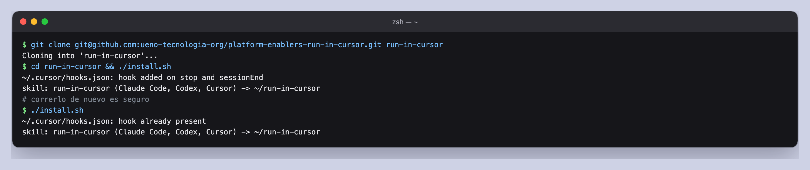
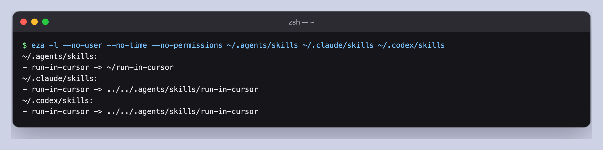
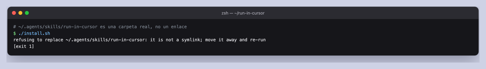
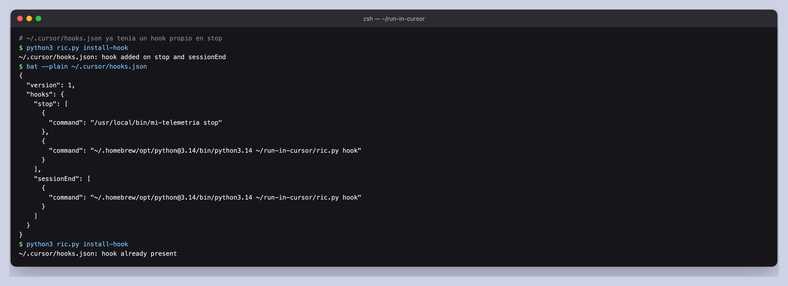
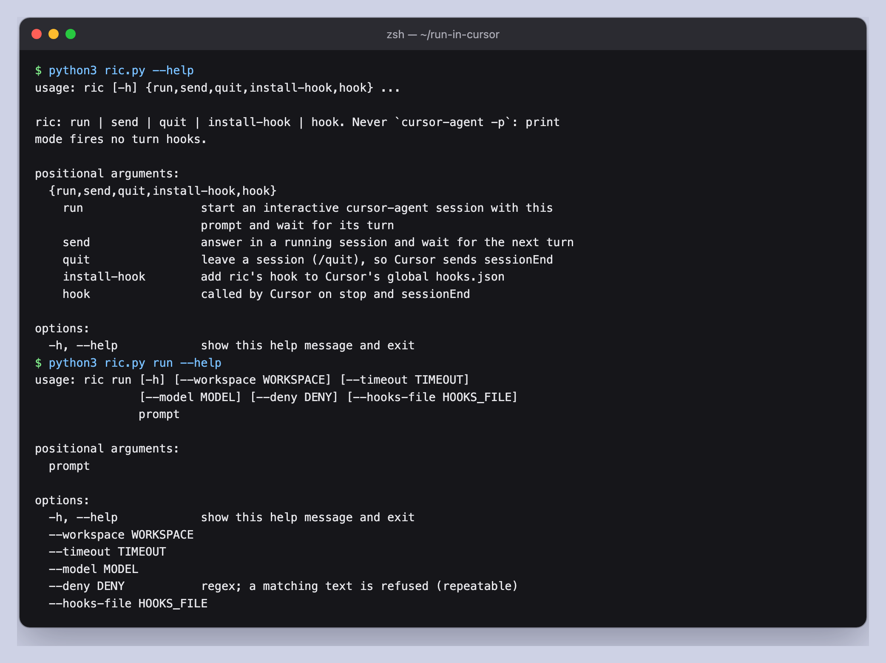
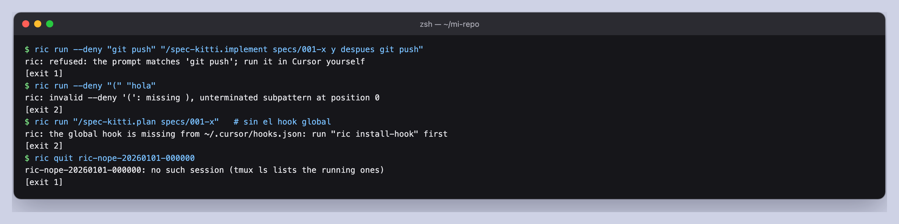

# Instalación detallada: comando por comando

> **¿Solo vas a usarlo conversando con tu agente?** Tenés la [instalación simple](instalacion.md), que usa solo prompts.
> Esta guía es para quien quiere ver (o correr) cada comando de `ric`, o instalarlo sin un agente.

Unos minutos para dejar la skill y el hook andando en Claude Code, Codex y Cursor, y entender qué rechaza `ric` antes de
abrir nada. Después de esto, el [showcase](showcase.md) muestra cada caso y la [referencia](referencia.md) tiene los
comandos y los códigos de salida.

| Paso | Qué hacés | Tiempo |
|---|---|---|
| [1. Requisitos](#1-requisitos) | Comprobar `python3`, `tmux`, `cursor-agent` y el acceso al repo | 2 min |
| [2. Instalar](#2-instalar) | Clonar y correr `./install.sh` | 1 min |
| [3. El hook global](#3-el-hook-global) | Qué agrega a `~/.cursor/hooks.json` y cómo se comporta | 2 min |
| [4. Primera corrida](#4-primera-corrida) | `ric run`, `ric send` y `ric quit` (gastan uso de Cursor) | 5 min |
| [5. Lo que `ric` rechaza antes de abrir nada](#5-lo-que-ric-rechaza-antes-de-abrir-nada) | `--deny`, hook faltante, sesión inexistente | 2 min |

> **Sobre las capturas.** Las terminales salen de ejecutar `install.sh` y `ric` de este repo con un `HOME` de prueba
> (nunca tu `~/.cursor`) y un repo vacío, sin abrir Cursor ni gastar uso. Las rutas se acortaron a `~`. **La
> corrida de `ric run` en sí no tiene captura**: abre un `cursor-agent` y gasta uso real. Al final hay una
> [tabla con el origen de cada imagen](#de-dónde-sale-cada-captura).

---

## 1. Requisitos

| Qué | Para qué | Cómo comprobarlo |
|---|---|---|
| `python3` 3.9 o más | `ric` usa solo la biblioteca estándar: no hay nada que instalar con `pip` | `python3 --version` |
| `git` y acceso por SSH a `josefigueredo` | Clonar el repo | `ssh -T git@github.com` |
| `tmux` | `ric` abre ahí el `cursor-agent` interactivo | `tmux -V` |
| `cursor-agent` con la sesión iniciada | Es el agente de Cursor que `ric` maneja | `cursor-agent --version`; para iniciar la sesión, `cursor-agent login` (abre el navegador) |

## 2. Instalar

```bash
git clone git@github.com:josefigueredo/run-in-cursor.git run-in-cursor
cd run-in-cursor && ./install.sh
```



*Salida real de `./install.sh` con un `HOME` de prueba, y de volver a correrlo (las rutas se acortaron).*

Qué hace `install.sh`, y qué no:

- **No copia nada.** Crea enlaces simbólicos a tu clon: `~/.agents/skills/run-in-cursor` apunta al repo, y
  `~/.claude/skills/run-in-cursor` y `~/.codex/skills/run-in-cursor` apuntan a `../../.agents/skills/run-in-cursor`.
  Cursor lee `~/.agents/skills` directamente, según el propio instalador.

  

- **Corre `ric install-hook`**, que es lo que imprime la primera línea de la captura (el paso 3 lo explica).
- **Avisa, pero no se detiene,** si falta `python3`, `tmux` o `cursor-agent`: imprime una línea `note:` y termina con
  código 1 al final.
- **Volver a correrlo es seguro.** Refresca los enlaces y no duplica el hook.
- **Nunca reemplaza una carpeta real** con el nombre de la skill: se detiene con código 1 y no sigue.

  

  *Salida real, con una carpeta real en `~/.agents/skills/run-in-cursor` de un `HOME` de prueba.*

- Un argumento que no conoce termina con `unknown argument: …` y código 2.

## 3. El hook global

`ric install-hook` suma el comando `ric hook` a `~/.cursor/hooks.json`, en `stop` y en `sessionEnd`, **sin tocar lo que ya
había**. Acá el archivo ya traía un hook propio en `stop`:



*Salida real sobre un `hooks.json` de prueba.*

Qué conviene saber:

- La entrada que agrega usa la **ruta completa del Python que la corrió** más la de `ric.py`, como se ve en la captura.
- Cursor corre los hooks globales en todos sus proyectos, pero `ric hook` solo escribe si la sesión la lanzó `ric` (si no
  existe `RUN_IN_CURSOR_LOG`, no hace nada). Qué guarda y cómo se ve, en el [showcase](showcase.md#5-qué-queda-registrado).
- Para usar otro archivo de hooks, `ric install-hook --hooks-file RUTA` (y `ric run --hooks-file RUTA`, que lo usa para
  comprobar que el hook está).
- Sin el hook, `ric run` se niega de entrada con código 2 (paso 5).

## 4. Primera corrida

**Estos tres comandos abren o tocan una sesión de Cursor y gastan uso real: no los corrimos para las capturas.** Para
probarlos, en un repo tuyo:

```bash
ric=~/.agents/skills/run-in-cursor/ric.py
python3 $ric run --workspace ~/mi-repo "/spec-kit.plan specs/001-x"   # abre la sesión y espera el turno
python3 $ric send ric-spec-kit-plan-AAAAMMDD-HHMMSS "SQLite" --workspace ~/mi-repo
python3 $ric quit ric-spec-kit-plan-AAAAMMDD-HHMMSS --workspace ~/mi-repo
```

- `ric run` imprime `session:`, `status:`, `tokens:` (cuando hay), `log:`, la pantalla entre `--- screen ---` y
  `--- end ---`, y una línea `next:` con el `send` y el `quit` ya armados.
- El nombre de la sesión es `ric-<primera palabra del prompt>-AAAAMMDD-HHMMSS`.
- Los logs quedan en `<repo>/.run-in-cursor/runs/<sesión>.jsonl`, y si el repo es de git y no la ignora ya,
  la carpeta se agrega a su `info/exclude` local (nunca al `.gitignore` versionado, así no ensucia la rama).
- Los parámetros de `run` (`--workspace`, `--timeout` en segundos —1800 por defecto—, `--model`, `--deny`, `--hooks-file`)
  están en esta captura de `ric --help` y `ric run --help`:



*Salida real.*

Códigos de salida: 0 completado, 1 abortado, error o rechazado, 124 timeout, 2 falta `tmux`, `cursor-agent` o el hook, o
un `--deny` inválido. Un timeout deja la sesión viva (`tmux attach -t <sesión>`).

## 5. Lo que `ric` rechaza antes de abrir nada

Estos cuatro casos se pueden correr sin gastar uso, porque `ric` los decide antes de abrir una sesión (primero
comprueba que `tmux` y `cursor-agent` estén en el `PATH`; de los cuatro, solo `quit` le habla a `tmux`, para ver si la
sesión existe):



*Salida real de `ric` (rutas acortadas); `[exit N]` es el código de salida.*

| Caso | Salida | Código |
|---|---|---|
| El texto coincide con un `--deny` | `ric: refused: the prompt matches '…'; run it in Cursor yourself` | 1 |
| El `--deny` no es una regex válida | `ric: invalid --deny '…': …` | 2 |
| No está el hook global | `ric: the global hook is missing from …: run "ric install-hook" first` | 2 |
| `quit` de una sesión que no existe | `<sesión>: no such session (tmux ls lists the running ones)` | 1 |

Sin `tmux` o sin `cursor-agent` en el `PATH`, cualquier `run`, `send` o `quit` termina con `ric: <herramienta> is not
on PATH` y código 2.

## De dónde sale cada captura

| Imagen | Origen |
|---|---|
| `terminal-instalar.png`, `terminal-enlaces.png`, `terminal-instalar-rechazo.png` | Salida real de `./install.sh` con un `HOME` de prueba (el clon se muestra como texto, sin correrlo) |
| `terminal-hook.png`, `terminal-registro.png` | Salida real de `ric install-hook` y de `ric hook`, con un `hooks.json` y un evento de ejemplo |
| `terminal-ayuda.png`, `terminal-rechazos.png` | Salida real de `ric --help`, `ric run --help` y de los cuatro rechazos |

Las fuentes de cada captura están en [`img/src/`](img/src/), por si hay que regenerarlas.
