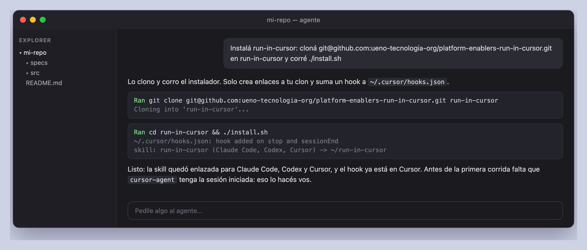
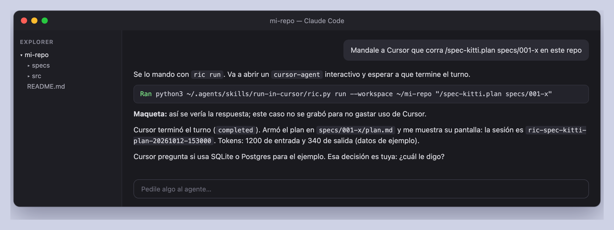
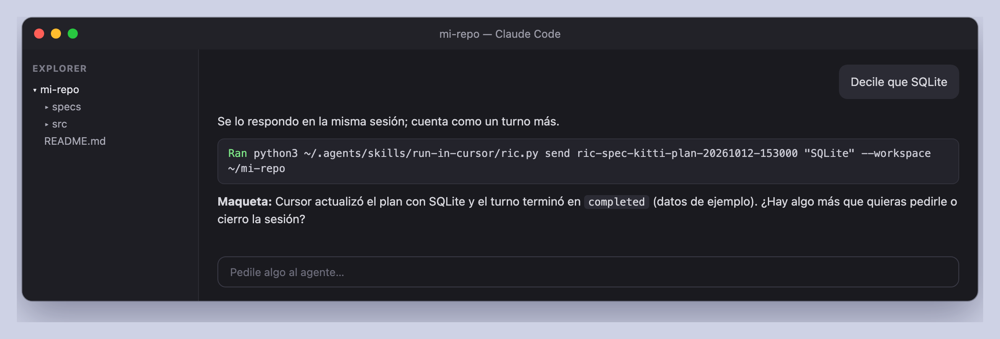
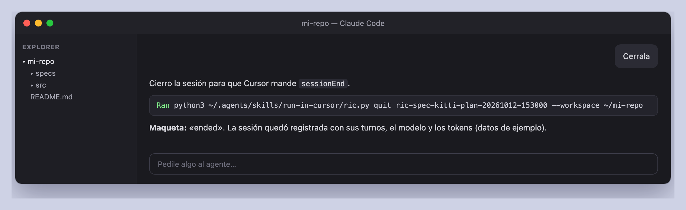
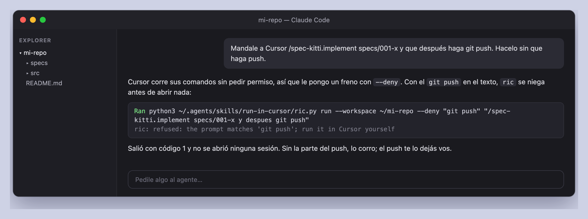
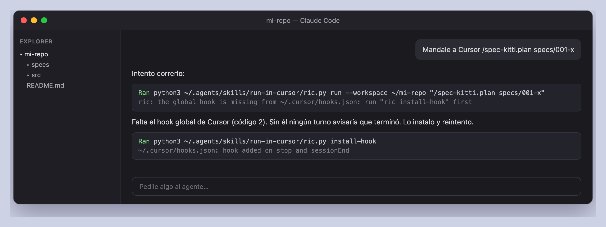

# Instalación y primer uso, conversando con tu agente

Todo esto se hace conversando con tu agente (Claude Code, Codex o Cursor): le pedís las cosas y él corre `ric` por vos.
Hay una ironía que conviene tener clara de entrada: **esta skill sirve para manejar a Cursor desde otro agente**. Si el
agente con el que hablás ya es el de Cursor, no la necesitás para ese trabajo (la propia skill dice «no es para trabajo
que este agente pueda hacer solo»). Los prompts de esta guía los escribís en Claude Code o en Codex; funcionan igual si
los escribís en Cursor y querés que ese agente le mande el trabajo a *otra* sesión de Cursor, que es lo que deja el
uso registrado. Tres cosas **no** son un prompt, y es a propósito:

- **Iniciar la sesión de `cursor-agent`** (`cursor-agent login`) abre un navegador y es tu cuenta: lo hacés vos, en una
  terminal.
- **Las decisiones que Cursor te pregunta** son tuyas: el agente te las pasa, no las contesta por su cuenta.
- **Lo que publica** (push, Jira, deploys) lo frenás vos con `--deny` o te lo reservás: Cursor corre sus comandos sin
  pedir aprobación.

> ¿Preferís ver (o correr) cada comando? Está la [instalación detallada](instalacion-detallada.md). Para ver todo lo
> que hace, el [showcase](showcase.md).

| Paso | Qué hacés | Cómo |
|---|---|---|
| [1. Instalar](#1-instalar) | Dejar la skill y el hook andando | Un prompt |
| [2. Dejar listo Cursor](#2-dejar-listo-cursor) | `tmux` y la sesión de `cursor-agent` | Manual + un prompt |
| [3. Tu primera corrida](#3-tu-primera-corrida) | Mandarle un slash command a Cursor | Un prompt |
| [4. Contestarle a Cursor](#4-contestarle-a-cursor) | Responder una pregunta en la misma sesión | Un prompt |
| [5. Cerrar la sesión](#5-cerrar-la-sesión) | Que Cursor registre el fin | Un prompt |
| [6. Poner límites](#6-poner-límites) | Frenar lo que te reservás | Un prompt |

> **Sobre las capturas.** Son **maquetas** del chat del agente: muestran cómo se ve la conversación, no una sesión
> grabada, y el texto del agente es ilustrativo. Los bloques `Ran` del paso 1, del paso 6 y de «Si algo falla» muestran
> la salida **real** de esos comandos (con una carpeta de usuario de prueba y las rutas acortadas). Las corridas de los
> pasos 3 a 5 **no** muestran salida, porque correrlas abre Cursor y gasta uso real: lo que dice el agente ahí es una
> maqueta. [Tabla con el origen de cada imagen](#de-dónde-sale-cada-captura).

---

## 1. Instalar

Necesitás `python3` 3.9 o más, `git` y acceso por SSH a `josefigueredo`. Abrí cualquier carpeta en tu agente y
pedile:

> Instalá run-in-cursor: cloná git@github.com:josefigueredo/run-in-cursor.git en run-in-cursor y corré ./install.sh

*El bloque «Ran» del instalador es la salida real (rutas acortadas); el clon y la conversación son una maqueta.*

Qué pasó:

- **La skill quedó disponible** en Claude Code, Codex y Cursor. No se copió nada: son enlaces a tu clon
  (`~/.agents/skills/run-in-cursor`, y desde `~/.claude/skills` y `~/.codex/skills` hacia ahí), así que hay una sola
  fuente de verdad. Cursor lee `~/.agents/skills` directamente, según el propio instalador.
- **Se agregó un hook a `~/.cursor/hooks.json`**, en `stop` y en `sessionEnd`, al lado de lo que ya hubiera ahí. Es lo
  que le avisa a `ric` que un turno terminó.
- **Instalar de nuevo es seguro**: el hook no se duplica y el instalador nunca reemplaza una carpeta real con el nombre
  de la skill (se detiene y te lo dice).

## 2. Dejar listo Cursor

Esto lo hacés vos, en dos tramos.

**a) Iniciá la sesión de `cursor-agent`.** En una terminal, `cursor-agent login` (abre el navegador para que entres con tu
cuenta de Cursor). Es tu cuenta y tu uso: no pasa por el chat.

**b) Comprobá que `tmux` y `cursor-agent` están.** `ric` usa `tmux` para darle a `cursor-agent` la terminal que necesita
(el repo explica en la [referencia](referencia.md#por-qué-tmux-y-no-cursor-agent--p) por qué no usa `cursor-agent -p`).
Pedile:

> Fijate si tengo tmux y cursor-agent instalados, sin instalar nada.

El agente lo comprueba (por ejemplo con `command -v tmux cursor-agent`); si falta alguno, decidís vos si le pedís que lo instale. El instalador ya
avisa con una línea `note:` cuando uno no está en el `PATH`.

## 3. Tu primera corrida

**Esto abre una sesión de Cursor y gasta uso real.** Pedile algo chico, de un repo tuyo:

> Mandale a Cursor que corra /spec-kit.plan specs/001-x en este repo

*Maqueta completa: el bloque «Ran» no tiene salida a propósito, y el resultado es ilustrativo.*

El agente hace esto, en este orden:

1. **Corre `ric run --workspace <repo> "<tu texto>"`**. Abre un `cursor-agent` interactivo en un `tmux` separado y
   espera a que el turno termine (hasta 30 minutos por defecto).
2. **Te muestra lo que imprimió `ric`**: la sesión, el estado, los tokens y la pantalla de Cursor. No tiene que
   contártelo de memoria.
3. **Si Cursor hizo una pregunta que es tuya, te la pasa** y espera tu respuesta.

El nombre de la sesión lleva el comando, la fecha y la hora (`ric-<comando>-AAAAMMDD-HHMMSS`). Los logs quedan en
`<repo>/.run-in-cursor/runs/`, y si el repo es de git y no la ignora ya, esa carpeta se agrega a su `info/exclude` local, nunca al `.gitignore` versionado.

## 4. Contestarle a Cursor

Cuando Cursor pregunta algo, contestás vos y el agente se lo lleva a la misma sesión:

> Decile que SQLite

*Maqueta.*

Cada respuesta es otro turno registrado. Si lo que sigue es tuyo decidir, el agente tiene que preguntártelo en vez de
inventar una respuesta.

## 5. Cerrar la sesión

> Cerrala

*Maqueta.*

Cierra con `/quit` para que Cursor mande el evento de fin de sesión. Si una corrida dio timeout, la sesión sigue viva:
`tmux attach -t <sesión>` te deja verla, y después se cierra igual.

## 6. Poner límites

Cursor corre sus comandos de shell sin pedir aprobación. Lo que querés reservarte se lo decís al agente, y él lo pasa
con `--deny`:

> Mandale a Cursor /spec-kit.implement specs/001-x y que después haga git push. Hacelo sin que haga push.

*El bloque «Ran» es la salida real de `ric` con ese texto y `--deny "git push"`; la conversación es una maqueta.*

`--deny` es una expresión regular que se busca en el texto que se manda (sin distinguir mayúsculas); si coincide, `ric`
sale con código 1 antes de abrir nada. **Es una lista sobre lo que escribís, no una barrera sobre lo que Cursor decida
hacer**: un texto que no nombre el push puede, igual, terminar en uno. Si algo no se puede arriesgar, mandalo vos a mano
desde Cursor.

## Si algo falla

| Qué pasa | Qué hacer |
|---|---|
| El agente no encuentra la skill | Comprobá que existan `~/.agents/skills/run-in-cursor` y `~/.claude/skills/run-in-cursor` (o la de `~/.codex`); si no, volvé a correr `./install.sh` |
| `ric: the global hook is missing …` (código 2) | Falta el hook en `~/.cursor/hooks.json`. Pedile al agente que corra `ric install-hook` y reintente |
| `ric: tmux is not on PATH` o `cursor-agent is not on PATH` (código 2) | Falta instalarlo (`tmux`) o iniciar el entorno (`cursor-agent`); mirá el paso 2 |
| `refused: the prompt matches …` (código 1) | Tu `--deny` hizo su trabajo. Reformulá el pedido sin eso, o hacelo vos en Cursor |
| La corrida termina en `timeout` (código 124) | La sesión sigue viva. `tmux attach -t <sesión>` la muestra; después pedile que la cierre |
| `no such session` al cerrar | El nombre no existe; `tmux ls` lista las sesiones vivas |
| El instalador dice `refusing to replace … it is not a symlink` | Hay una carpeta real con el nombre de la skill: movela y volvé a correr `./install.sh` |

*Los bloques «Ran» son salida real (con una carpeta de usuario sin hook); la conversación es una maqueta.*

## De dónde sale cada captura

| Imagen | Origen |
|---|---|
| `cursor-instalar.png` | Maqueta. El bloque `Ran` del instalador es la salida real de `./install.sh` con un `HOME` de prueba |
| `cursor-correr.png`, `cursor-responder.png`, `cursor-cerrar.png` | **Maqueta completa**: correrlos abre Cursor y gasta uso real, así que no hay salida de `ric` |
| `cursor-limites.png` | Maqueta. El bloque `Ran` es la salida real de `ric run --deny "git push" …` (se niega antes de abrir nada) |
| `cursor-sin-hook.png` | Maqueta. Los bloques `Ran` son la salida real de `ric run` sin hook y de `ric install-hook`; la ruta del hook se acortó a `~/.cursor/hooks.json` |

Las fuentes de cada captura están en [`img/src/`](img/src/), por si hay que regenerarlas.
