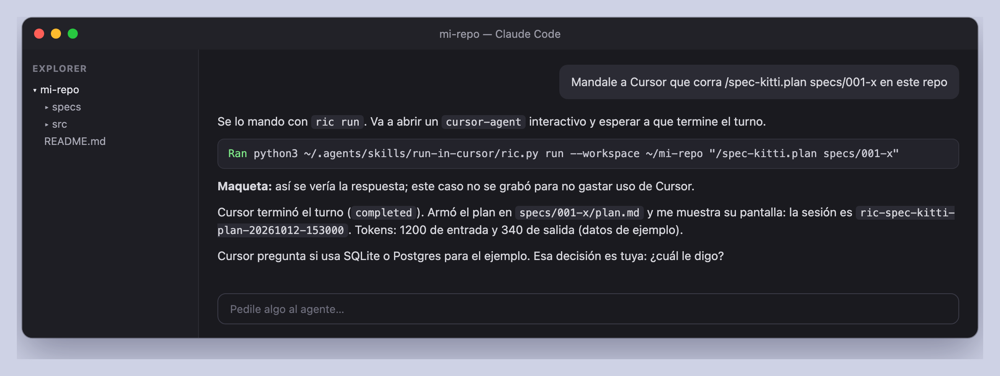
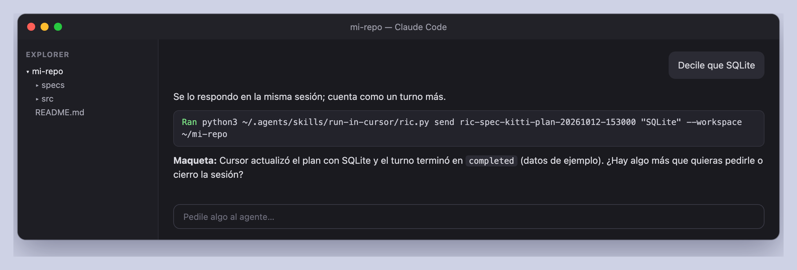
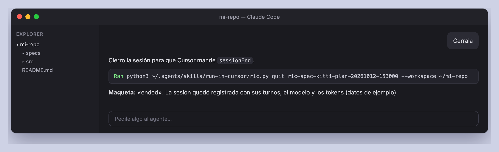
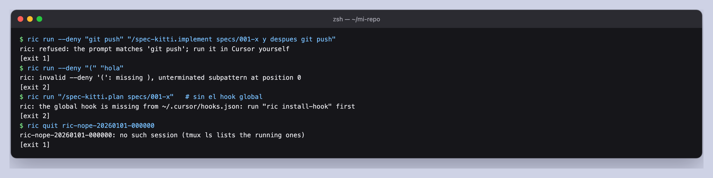
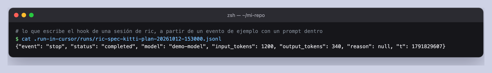
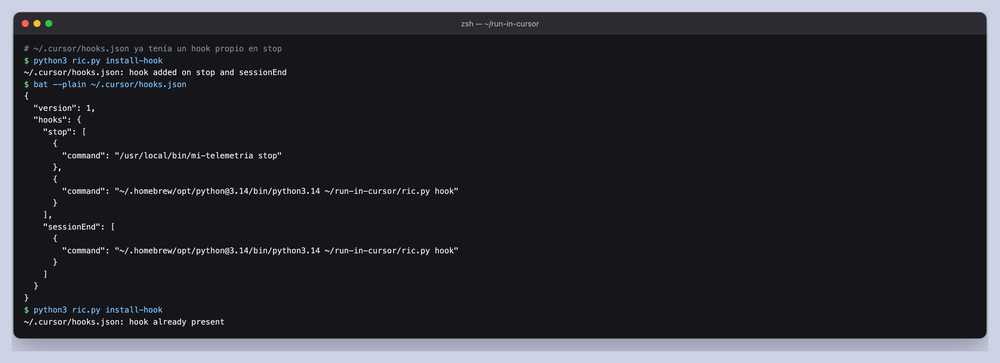

# Showcase

Qué se puede hacer con `run-in-cursor`, caso por caso: qué le decís al agente, qué comando corre por detrás y qué ves
en pantalla. Para instalarlo, la [guía de instalación](instalacion.md) (con prompts) o la
[detallada](instalacion-detallada.md) (con comandos); para cada comando y código de salida, la [referencia](referencia.md).

| Componente | Escenario | Ir al caso |
|---|---|---|
| `ric run` | «Mandale a Cursor `/spec-kit.plan specs/001-x`» | [Mandar un slash command](#1-mandar-un-slash-command-a-cursor) |
| `ric send` | «Decile que SQLite» | [Contestarle a Cursor](#2-contestarle-a-cursor-cuando-pregunta) |
| `ric quit` | «Cerrala» | [Cerrar la sesión](#3-cerrar-la-sesión) |
| `--deny` | «Mandale esto, pero que no haga push» | [Frenar lo que te reservás](#4-frenar-lo-que-te-reservás) |
| `ric hook` | «¿Qué quedó registrado de esa sesión?» | [Qué queda registrado](#5-qué-queda-registrado) |

> **Sobre las salidas.** Correr `ric run` o `ric send` abre un `cursor-agent` de verdad y gasta uso de Cursor, así que
> acá **no se grabó ninguna corrida**: los casos 1 a 3 muestran el comando y lo que el agente respondería, como
> **maqueta** y con datos de ejemplo. Los casos 4 y 5 sí muestran salida real: son rechazos que `ric` decide antes de
> abrir nada, y lo que escribe el hook ante un evento de ejemplo.

---

## Lo que lo distingue

| | |
|---|---|
| **Uso real de Cursor** | La sesión es un `cursor-agent` interactivo dentro de `tmux`: según lo que midió el repo el 2026-10-06, así llegan a los hooks el turno, el modelo y los tokens (`cursor-agent -p` no los dispara). La [referencia](referencia.md#por-qué-tmux-y-no-cursor-agent--p) tiene la tabla |
| **Esperar al turno** | `ric` espera a que el hook anote un `stop` nuevo y recién ahí imprime. Sin hook global se niega de entrada (código 2) en vez de esperar el timeout |
| **Un hook que no molesta** | El hook global solo escribe en las sesiones que lanzó `ric` (usa `RUN_IN_CURSOR_LOG`), contesta `{}` y está escrito para no fallar |
| **Una lista de rechazo** | `--deny` frena textos antes de enviarlos; vale igual en `run` y en `send` |
| **Logs locales** | Cada sesión deja un `.jsonl` en `<repo>/.run-in-cursor/runs/`, fuera del git del repo |

---

## 1. Mandar un slash command a Cursor

**Componente:** `ric run` · **Gasta uso de Cursor:** sí · **Corre comandos con `--force`:** sí.

Tenés un flujo armado en Cursor (por ejemplo los comandos de Spec-Kit) y querés disparar un paso desde Claude Code o
Codex, con la sesión contada como uso real de Cursor.

*Maqueta de la conversación; el bloque «Ran» no tiene salida porque no se corrió.*

### Qué corre el agente

| # | Comando | Para qué | ¿Gasta uso? |
|---|---|---|---|
| 1 | `ric run --workspace ~/mi-repo "/spec-kit.plan specs/001-x"` | Abrir la sesión, esperar el turno e imprimir sesión, estado, tokens y pantalla | Sí |
| 2 | *(lee lo que imprimió)* | Mostrarte la pantalla de Cursor, no su resumen | No |

Agregá `--model M` solo si nombraste un modelo, `--timeout S` si el turno puede pasar de 30 minutos (el valor por defecto
es 1800 s), y `--deny` para lo que te reservás (caso 4).

**Qué pasa si algo sale mal**

| Situación | Resultado |
|---|---|
| Falta `tmux` o `cursor-agent` | `ric: <herramienta> is not on PATH`, código 2 |
| Falta el hook global | Se niega de entrada, código 2 ([captura](img/terminal-rechazos.png)) |
| El turno no termina a tiempo | Estado `timeout`, código 124; la sesión sigue viva y se mira con `tmux attach -t <sesión>` |
| Cursor aborta o da error | Código 1, con la pantalla impresa |

## 2. Contestarle a Cursor cuando pregunta

**Componente:** `ric send` · **Gasta uso de Cursor:** sí.

Cursor pidió una decisión. La decisión es tuya; el agente te la pasa y, con tu respuesta, la lleva a la misma sesión.

*Maqueta.*

| # | Comando | Para qué |
|---|---|---|
| 1 | `ric send <sesión> "SQLite" --workspace ~/mi-repo` | Escribir la respuesta en la sesión y esperar el turno siguiente |

Cada respuesta es otro turno registrado. Una respuesta que empieza con `/` corre como slash command, así que `--deny`
vale en `send` igual que en `run`.

## 3. Cerrar la sesión

**Componente:** `ric quit` · **Gasta uso de Cursor:** no.

*Maqueta.*

| # | Comando | Para qué |
|---|---|---|
| 1 | `ric quit <sesión> --workspace ~/mi-repo` | Mandar `/quit` (con un segundo Enter, porque el primero lo toma el autocompletado) para que Cursor mande `sessionEnd` |

| Situación | Resultado |
|---|---|
| La sesión no existe | `<sesión>: no such session (tmux ls lists the running ones)`, código 1 ([captura](img/terminal-rechazos.png)) |
| La sesión sigue viva tras el cierre | Lo dice, con el `tmux attach -t <sesión>` para mirarla, y sale con código 1 |

## 4. Frenar lo que te reservás

**Componente:** `--deny` · **Gasta uso de Cursor:** no, si se niega.

Cursor corre con `--force`: sus comandos de shell no piden aprobación. Si hay algo que querés hacer vos (un push, una
escritura en Jira, un deploy), el agente se lo pasa a `ric` como una expresión regular.

*Salida real de `ric` (rutas acortadas). Ninguno de estos comandos abre Cursor.*

**Qué te protege y qué no**

| Situación | Resultado |
|---|---|
| El texto coincide con un `--deny` | `ric: refused: …`, código 1, ninguna sesión |
| El `--deny` no es una regex válida | `ric: invalid --deny …`, código 2, ninguna sesión |
| El texto **no** nombra lo que querías frenar | Pasa. `--deny` mira el texto que enviás, no lo que Cursor decida hacer después |
| Querés que Cursor nunca toque algo | `--deny` no alcanza: dejalo para hacerlo vos |

## 5. Qué queda registrado

**Componente:** `ric hook` · **Gasta uso de Cursor:** no.

El hook global corre en cada proyecto de Cursor, pero solo escribe si la sesión la lanzó `ric` (si no está
`RUN_IN_CURSOR_LOG`, no hace nada). De cada evento guarda el estado, el modelo, los tokens y el motivo; **no guarda el
prompt ni los archivos**. Esta captura alimenta el hook con un evento de ejemplo que trae un prompt adentro:

*Salida real de `ric hook`, con un evento de ejemplo en vez de una sesión de Cursor.*

Para instalarlo, `ric install-hook` lo suma a `stop` y `sessionEnd` **sin tocar lo que ya hay**:

*Salida real sobre un `~/.cursor/hooks.json` de prueba.* Fijate que el hook queda registrado con la ruta del Python
que corrió `install-hook`: si ese Python se muda o desaparece, el hook deja de andar. Según el código, volver a correr `ric install-hook` no
lo reemplaza (ya reconoce una entrada de `ric` y no agrega otra): habría que corregir esa línea de `hooks.json` a mano.
